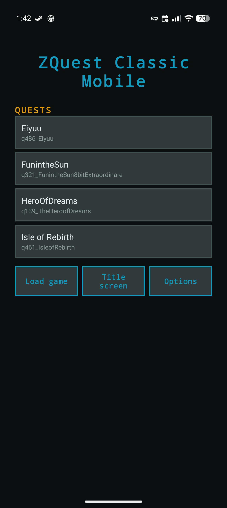

<p align="center">
  
</p>

# ZQuest Classic Mobile

An unofficial, touch-first Android port of the [ZQuest Classic](https://github.com/ZQuestClassic/ZQuestClassic) player. Play the same `.qst` quests on your phone with an emulator-style on-screen pad, a native cog menu, and true quick save states.

[Latest Android builds](https://github.com/reeseroyster/zquestclassic-android/releases) · [Upstream project](https://github.com/ZQuestClassic/ZQuestClassic) · [How to play](https://zquestclassic.com/docs/how-to-play/)

> **What this is:** this port was built almost entirely by an AI agent (Hermes, on a Nous Research model) as a proof of concept — "can a desktop Zelda-like engine become a real mobile app?" It has since grown into a genuinely playable app: quests load, controls work, settings persist, and save states restore the live world. It is still a preview, not an official release, and it is **not affiliated with the ZQuest Classic team**. All engine credit belongs to them; this repo only adds the Android shell and mobile UX.

## Features

- **Emulator-style touch pad** — GBA/NES-inspired layout (A/B, L/R, Start/Map) with a floating analog stick, modelled on Dolphin/PPSSPP overlays.
- **Native cog menu** — a mobile-first replacement for the desktop menu: Home, Save, Load, Quick Save, Quick Load, Pad, Settings, Pause, Step, Keyboard.
- **True quick save states** — per-quest snapshots that restore the exact map/screen, hero position, enemies, items, weapons, FFCs and screen objects, as if nothing after the save happened. Separate from normal named save slots.
- **ZQuest-themed UI** — library and menus styled with ZQuest's own palette and hard-edged panels; adaptive launcher icon.
- **Phone-correct rendering** — aspect-correct fit, immersive fullscreen, rotation, and runtime `WindowInsets` so the UI clears the status bar and cutouts on any device.
- **Full configuration surface** — the engine's settings, control-scheme editor, and text entry all work on-device.

## Supported devices

- Android 6.0+ (`minSdk 23`), `targetSdk 35`.
- Native builds for `arm64-v8a` and `x86_64`.
- Tested on a Pixel 10 Pro and in Waydroid (Lineage 20).

## Install

**Obtainium (recommended):** add `https://github.com/reeseroyster/zquestclassic-android` as a GitHub source, enable *Include prereleases*, and track the `app-debug.apk` asset. Updates then arrive as new prereleases.

**Manual:** download `app-debug.apk` from the [latest release](https://github.com/reeseroyster/zquestclassic-android/releases) and sideload it. Then grant a quest folder (or import a `.qst`) from the library and tap a quest to play.

## Building

The Android app lives in [`android/`](./android). With an Android SDK + NDK (r27d), JDK 21, CMake and Gradle on the path:

```sh
cd android
gradle --no-daemon :app:assembleDebug
# APK at app/build/outputs/apk/debug/app-debug.apk
```

The engine is the upstream ZQuest Classic C++ core compiled for Android via Allegro; the mobile shell is Java (`PlayerActivity` / `MainActivity`) plus a small JNI layer for save states and input.

## Images

| Library | Gameplay |
| --- | --- |
|  |  |

## Credits & license

Engine, quests format, and all original game code: [ZQuest Classic](https://github.com/ZQuestClassic/ZQuestClassic) and its contributors. This repository is an independent Android port and preview distribution.

GPLv3, same as upstream. See the [LICENSE](./LICENSE).