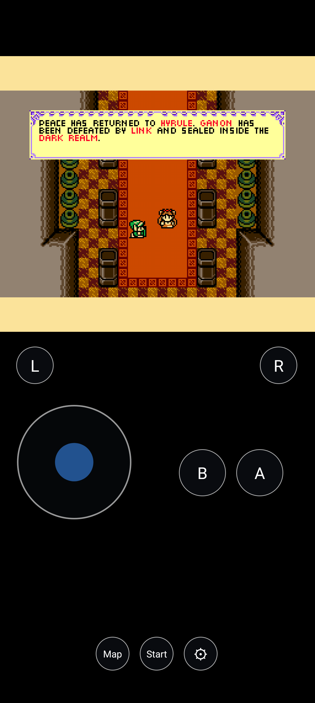
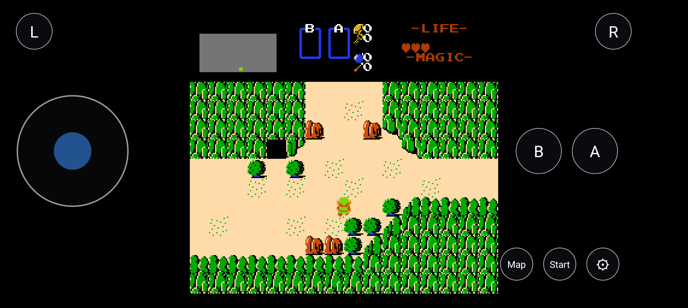
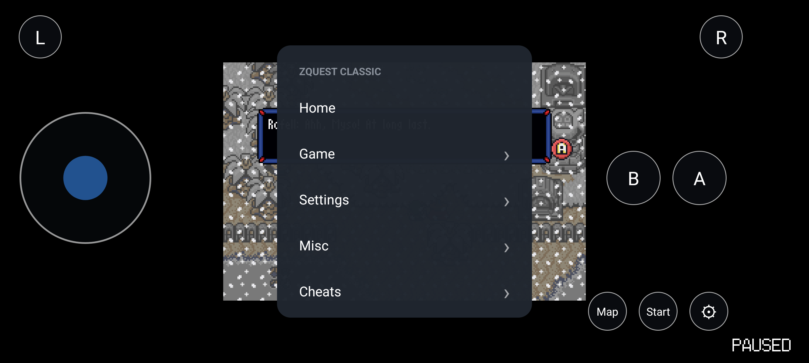

  

# ZQuest Classic Mobile

**All the credit goes to the people who actually made ZQuest Classic and Zelda Classic.** The game, the engine, the quest format, everything that makes this worth playing — that's their work, and this port would not exist without it. Think of this as their game running somewhere it never ran before.

This repo did none of that work. It is simply the existing ZQuest Classic engine, ported to Android **by an AI agent** — we wrote almost nothing ourselves. If you enjoy this, thank [the ZQuest Classic team](https://github.com/ZQuestClassic), not us. And if you want to build or contribute to the real thing, [upstream](https://github.com/ZQuestClassic/ZQuestClassic) is the place to do it.

It's an open-source early alpha — rough edges expected, and honest help genuinely welcome. But the authors of record, always, are upstream's.

[Preview builds](https://github.com/reeseroyster/zquestclassic-android/releases) · [Upstream project](https://github.com/ZQuestClassic/ZQuestClassic) · [Port patch](./android-port.patch)

## Status

Early alpha. Quests load and play on a phone with touch controls and proper
save/load, but nothing here is polished or guaranteed. This is not an official
release and is not affiliated with the ZQuest Classic team — all engine credit
belongs to them.

## Contributing

This is meant to grow past one person. It began as a proof of concept and is now
open-source — **pull requests are just as welcome as issue reports.** Current
priorities if you want a place to start:

- **Physical gamepad/controller support** (the next item on the roadmap)
- Porting the **quest editor** to mobile
- **Testing on more devices** (audio, touch layout, orientation)

The whole thing is built with an AI agent doing much of the scaffolding and
testing, so the bar to contribute is low and the help is genuinely wanted.
Open an issue to chat about an idea first if you like, or jump straight in.

## Install

Grab the latest `ZQuestClassicMobile-*.apk` from the [releases page](https://github.com/reeseroyster/zquestclassic-android/releases) and sideload it, or track this repo with [Obtainium](https://github.com/ImranR98/Obtainium) (enable *Include prereleases*) to get updates automatically. Then grant a quest folder or import a `.qst` and tap a quest to play.

## What's in this repo

- **[Releases](https://github.com/reeseroyster/zquestclassic-android/releases)** — prebuilt preview APKs (`arm64-v8a` + `x86_64`, Android 6+).
- **[`android-port.patch`](./android-port.patch)** — the Android shell and mobile changes, applied against upstream ZQuest Classic.

The engine itself is upstream's C++ core; this repo only adds the Android layer and distributes preview builds.

## Images

The app adapts to any screen orientation — here it is in portrait and landscape.

**Quest library · portrait**

**Gameplay · portrait**

**Gameplay · landscape**

**In-game settings**

## License

GPLv3, same as upstream. See [LICENSE](https://github.com/ZQuestClassic/ZQuestClassic/blob/main/LICENSE).